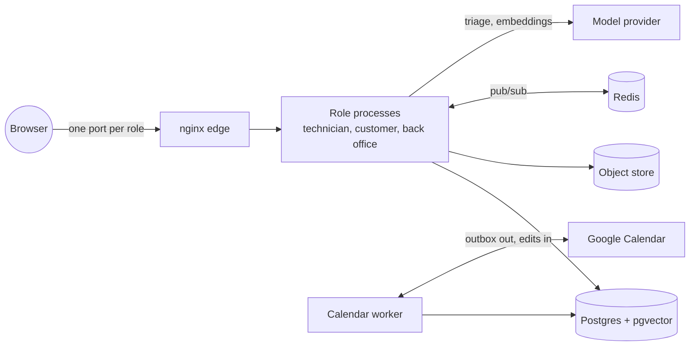

# Field Service Management

A service-call management system for agencies like elevator or appliance maintenance companies,
with AI assistance for the customer: a triage chat, grounded in the agency's knowledge base, that
resolves the issue or escalates it to a booked visit. Customers, technicians and the back office
each have an app of their own, and bookings land on the technicians' Google Calendars. The stack
runs under Docker Compose, on one machine or on an EC2 instance behind CloudFront.

The [**visual walkthrough**](https://erancha.github.io/field-service-management/samples/walkthrough/)
shows it running without deploying anything: annotated screenshots from one uninterrupted session,
starting on an empty database and ending with a booked appointment in two Google Calendars.

**Contents:** [Overview](#overview) · [Tech stack](#tech-stack) · [Architecture](#architecture) ·
[Getting started](#getting-started) · [Scripts](#scripts) · [Details](#details) ·
[License](#license)

## Overview

- **Three apps, one sign-in**: customers, technicians and the back office each use their own app
  at its own address, and sign in with Google only. The app a person signs in at decides their
  role; an administrator approves a technician before customers can book them.
- **Self-booking on real availability**: customers book a visit against a technician's working
  hours, time off, public holidays and Google free/busy. The database itself refuses two
  overlapping appointments for one technician, and every booking change is audited.
- **Google Calendar both ways**: each appointment lands on the technician's calendar with the
  customer as a real guest, and edits made on Google's side come back; a technician grants access
  only to a calendar the app creates and to free/busy times.
- **AI triage chat**: the assistant works the problem with the customer, answers from the
  agency's uploaded manuals with a link to the page it used, and either closes the conversation
  or, on the customer's yes, opens a service call with a structured summary for the technician.
- **Photos in the chat**: a customer can attach photos of a rating plate or an error display;
  the assistant reads a downscaled copy and stops at once on a safety risk it sees.
- **Knowledge base**: the back office uploads the documents the assistant answers from, which
  are chunked, embedded and searchable.
- **Live updates and notifications**: an approval or a booking reaches every open app at once,
  with an in-app feed for both parties and email to the technician.

## Tech stack

- **Backend** — Python 3.12, FastAPI on uvicorn, SQLAlchemy 2 and Alembic; a modular monolith of
  bounded contexts whose import rules import-linter enforces
- **AI** — LangChain with an Anthropic or OpenAI chat model and OpenAI embeddings, each chosen by
  one setting; pgvector for retrieval
- **Storage** — Postgres 16 with pgvector; a RustFS object store for photos; Redis as the pub/sub
  broker between processes
- **Frontend** — React and TypeScript built with Vite, served by the nginx edge
- **Auth** — Google OpenID Connect with PKCE and signed session cookies; the technicians' Google
  refresh tokens encrypted at rest (Fernet)
- **Runtime** — Docker Compose: an nginx edge, replicas per role, a calendar worker, Postgres,
  Redis and the object store, on the workstation or on one EC2 instance behind CloudFront
  (CloudFormation)
- **Tests** — pytest with Testcontainers, ruff, mypy and import-linter; Vitest and oxlint for the
  frontend; GitHub Actions runs both

## Architecture

One backend image runs as a process per role, technician, customer and back office, each scaled to
its own number of replicas behind an nginx edge that serves the page and gives each role a port of
its own. A worker process runs the two-way calendar sync, Redis carries live events between the
processes, and Postgres is the source of truth.

**[Architecture](docs/architecture.md)** continues from here: the bounded contexts and their import
rules, the runtime topology, authentication and live events, and the database.

## Getting started

Needs Docker; the tests also need Python 3.12+ and Node.js 22.

1. Create a Google OAuth web client in a Google Cloud project of your own, with the Google
   Calendar API enabled, the sign-in and calendar scopes, your Google account as a test user, and
   these redirect URIs: `http://localhost:8001/auth/google/callback`, the same for `:8002` and
   `:8003`, and `http://localhost:8001/calendar/connect/callback`
   ([Sign-in](docs/sign-in.md#setting-up-google) walks the console).
2. Run `./scripts/deploy.sh`. The first run creates the gitignored settings files under
   `scripts/lib/` from their `.example.sh` files, which explain each setting, with a generated
   database password, session secret, token key and store key, then stops and names each
   setting left to fill in: `GOOGLE_CLIENT_ID` in `params.sh` and `GOOGLE_CLIENT_SECRET` in
   `secrets.sh`. Put your own address in `ADMIN_EMAILS` of `params.sh` too, and, for the triage
   chat and the knowledge base, the model providers' keys in `secrets.sh`.
3. Run `./scripts/deploy.sh` again. It builds the images, starts the stack and returns once each
   role answers.
4. Open the back office at http://localhost:8003 and sign in, then the technician app at
   http://localhost:8001 and the customer app at http://localhost:8002.
5. To run the stack on AWS instead, on loan-simulator's EC2 instance behind CloudFront, run
   `./scripts/deploy.sh --ec2`. It also names the access key pair and region to fill in in
   `aws-config.sh`, and at the end prints each role's CloudFront address and the redirect URIs to
   add to the Google client
   ([Development & deployment](docs/development.md#deployment-scripts-scripts)).

`./scripts/docker-helper.sh --stop` takes the stack down and keeps its data; `--volumes` drops it
too. `./scripts/test.sh` runs every test target. [Development & deployment](docs/development.md)
has the settings, the addresses and the tests.

## Scripts

- `init-env.sh` — creates the gitignored settings files under `scripts/lib/`, with the generated
  secrets; `deploy.sh` runs it first
- `test.sh` — the checks and tests of the backend, the scripts and the frontend
- `deploy.sh` — builds and starts the stack in Docker; `--ec2` does it on an EC2 instance behind
  CloudFront
- `docker-helper.sh` — stops the stack, follows its logs or shows its status

Each script's header comment is its full documentation, and `--help` prints it.

## Details

- [Architecture](docs/architecture.md) — the bounded contexts, the import rules, the runtime
  topology and the database
- [Features & roadmap](docs/features.md) — what each role sees, surface by surface, and the open
  work
- [Authentication & live communication](docs/auth-and-communication.md) — the sign-in, calendar
  connect and approval flows end to end, and running a role on several replicas
- [Sign-in](docs/sign-in.md) — how sign-in works and how to set up the Google side
- [Google Calendar connect](docs/calendar-setup.md) — the calendar scopes, a rejected connect and
  re-consent
- [Database schema](docs/data.md) — the tables, the integrity guarantees and the calendar sync
- [Development & deployment](docs/development.md) — the settings files, the tests, the scripts
  and the addresses
- [Testing](docs/testing.md) — what each test layer proves
- [Decisions](docs/adr/) — one record per decision: the EC2 deployment

## License

Source-available under the [PolyForm Noncommercial License 1.0.0](LICENSE). Reading the source,
forking it and running a private deployment are free for anyone, companies included:
[NOTICE](NOTICE) grants that explicitly for evaluating the project or its author. Building a
commercial product or service on it needs a commercial license: erancha@gmail.com.

---

More projects by the author: [github.com/erancha](https://github.com/erancha)
