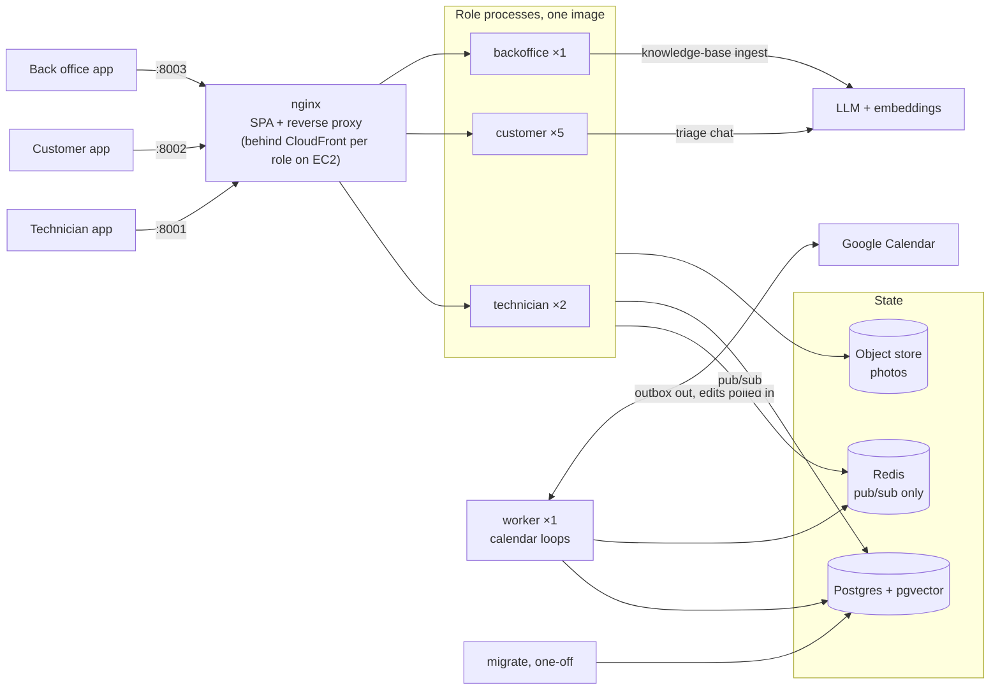

# Architecture

This document details the architecture the [README](../README.md#architecture) summarizes: the
Compose services the stack runs, sign-in and live events, the calendar sync, the edge on EC2,
where the data lives and how the code is laid out. Each section is a summary that links the topic
document holding the detail; each decision has a record under [adr/](adr/). How to run the stack
is in [Development & deployment](development.md), and how each part is tested in
[Testing](testing.md).

**Contents:** [One body of code, several entry points](#one-body-of-code-several-entry-points) ·
[The entry points](#the-entry-points) · [Sign-in and live events](#sign-in-and-live-events) ·
[Calendar sync](#calendar-sync) · [Configuration](#configuration) · [The edge](#the-edge) ·
[Host or guest on EC2](#host-or-guest-on-ec2) · [Storage](#storage) ·
[Codebase structure](#codebase-structure)

## One body of code, several entry points

One backend image runs as several role processes that differ only by `FSM_ROLE`, plus the
calendar worker and the schema migration, so every runtime shares one body of code, the `fsm`
package. `docker-compose.yml` sets each role's replica count, and nginx is the only published
entry point: on this machine a port per role, on an EC2 instance, which the stack may share with
other repos, the same ports behind a CloudFront distribution per role.

A role scales by changing its `replicas` count: nginx forwards each role's API to that role's
service name, which Docker resolves to every replica, and spreads requests round-robin with no
sticky sessions, since the session is a signed cookie and live events reach any process through
Redis ([Running a role across several
replicas](live-events.md#running-a-role-across-several-replicas)).

## The entry points

Every route a role answers is in [API endpoints](api.md), the work no request waits on in
[Workers' responsibilities and flows](workers.md).

- `technician` ×2 — `uvicorn fsm.platform.app:create_app` with `FSM_ROLE=technician`: the
  technician app's API, sign-in and calendar connect, at the edge's port 8001.
- `customer` ×5 — the same with `FSM_ROLE=customer`: booking, the triage chat and its photos, at
  the edge's port 8002.
- `backoffice` ×1 — the same with `FSM_ROLE=backoffice`: approvals, the knowledge base, the
  administrator's views, at the edge's port 8003.
- `worker` ×1 — `python -m fsm.platform.worker`: the outbound calendar dispatcher and the inbound
  poller; no port.
- `migrate` — `alembic upgrade head`, once per start, before the roles; no port.
- `nginx` — the built page and the reverse proxy, one server block per role, on ports 8001 to
  8003.
- `db`, `redis`, `objectstore` — Postgres with pgvector, the pub/sub broker, the photo store, on
  the loopback interface only.

## Sign-in and live events

Google OIDC is the only sign-in path, and the role a sign-in grants comes from the role of the
process that completes it, never from client input ([Sign-in](sign-in.md)); a technician's
calendar is a second consent on the same client
([Google Calendar connect](calendar-setup.md)). Once signed in, the frontend drives the system
with REST calls and receives live updates over a single Server-Sent Events stream, fanned out
across the role processes by Redis pub/sub ([Live events across replicas](live-events.md)).

## Calendar sync

PostgreSQL is the source of truth; Google Calendar is a downstream projection. A booking change
enqueues an outbox row in its own transaction, and the worker drains the outbox to Google and
polls Google for the technicians' edits, resolving any conflict in the database's favour
([Workers' responsibilities and flows](workers.md#the-worker-service)).

## Configuration

Every backend process reads its settings from environment variables, which the scripts export
from three files under `scripts/lib/` before they call Compose: the committed `stack-params.sh`,
and the gitignored `params.sh` and `secrets.sh`. The files and their keys are in
[Development & deployment](development.md#configuration).

## The edge

The edge is the one way into the stack: the `nginx` service, with a port per role
([The edge](api.md#the-edge-nginx-service)), and on EC2 a CloudFront distribution per role in front
of it. There each role is a CloudFormation stack, `field-service-management-tech`, `-app` and
`-admin`, which opens the role's port to CloudFront and adds the role's distribution
([ADR 0001](adr/0001-guests-on-loan-simulators-ec2-instance.md)).
[The EC2 stack](development.md#the-ec2-stack) has what `deploy.sh --ec2` deploys and how images
and settings reach the instance.

## Host or guest on EC2

The instance serves the other Docker Compose repos too: one stack is its host, and the others join
it as guests, each with its own port and CloudFront distribution. The technician's stack hosts the
instance unless `EC2_HOST_STACK` names another repo's host stack
([ADR 0002](adr/0002-any-docker-repo-can-host-the-instance.md)).

## Storage

Every table, its keys and the integrity guarantees the database enforces (no double-booking, the
transactional calendar outbox, the append-only appointment audit) are in
[Data model](data-model.md).

- **Postgres** (volume `fsm_pgdata`) is the source of truth, the knowledge base's vectors in
  pgvector included.
- **The object store** (RustFS, spoken to over S3, volume `fsm_objectstore`) holds the customers'
  photos, with only their metadata rows in Postgres.
- **Redis** keeps nothing: it serves only as the pub/sub broker, so an event published in one
  process reaches the event streams held by every other.

Both volumes are named Docker volumes on either target.

## Codebase structure

The backend is a modular monolith whose bounded contexts never import each other
([Design patterns](design-patterns.md)).

- `backend/` — `src/fsm/` with the contexts `assist`, `identity`, `scheduling`,
  `google_calendar` and `notifications`, the composition root `platform`, and `shared` and
  `core`; `alembic/` migrations, its tests and the Dockerfile.
- `frontend/` — the React page.
- `nginx/` — the edge's configuration and its Dockerfile, which bakes in the built page.
- `scripts/` — the operational scripts and `common.sh`, which they share
  ([Development & deployment](development.md#deployment-scripts-scripts)).
- `samples/` — the cross-process event sample that `./scripts/test.sh e2e` runs, sample
  knowledge-base documents and photos, and the visual walkthrough.
- `docs/` — this document, the topic documents and `adr/`.
- `.github/workflows/` — the CI workflow.
