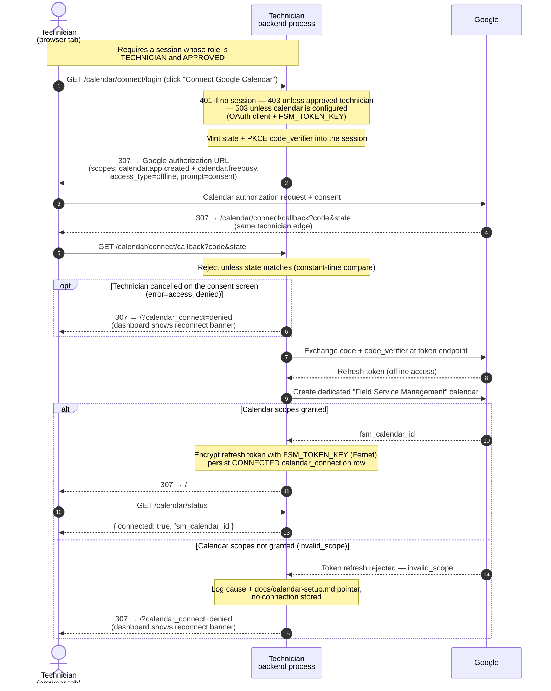

# Google Calendar connect

This document details the technician's calendar connect that [Sign-in](sign-in.md) summarizes:
how connecting works, why a connect is rejected and how to fix it, and re-consent after a scope
change. What the connected calendar is then kept in sync with is in
[Workers' responsibilities and flows](workers.md#the-worker-service).

The technician "Connect Google Calendar" flow requests exactly two narrow scopes and never the broad
`.../auth/calendar` scope, so the system can only ever touch the calendars it creates and read
free/busy intervals — the technician's private events stay invisible by construction.

Required scopes:

- `https://www.googleapis.com/auth/calendar.app.created` — create the per-technician "Field Service
  Management" calendar and manage events on it.
- `https://www.googleapis.com/auth/calendar.freebusy` — read opaque busy/free intervals for conflict
  detection.

## How connecting works

Connecting a technician's Google Calendar is a second OAuth consent, separate from sign-in: it
shares the same OAuth client but requests only the two scopes above and uses its own redirect URI
(`/calendar/connect/callback`). It is gated on an **approved** technician session, not on
authentication alone: connecting a calendar is what puts its owner into customer-facing pooled
availability, so a signed-in technician still waiting on (or refused by) the back office is rejected
with 403. The refresh token Google returns is encrypted at rest with `FSM_TOKEN_KEY` before it is
stored, so the database never holds a usable token in plaintext.

## When a connect attempt is rejected

When Google hands back a token without the calendar scopes, the first Google API call fails with
`invalid_scope`; the callback logs the cause (`Calendar connect failed for technician … See
docs/calendar-setup.md`), stores no connection, and sends the technician back to the app
(`/?calendar_connect=denied`), where the dashboard shows a dismissible "reconnect and allow calendar
access" banner. Cancelling on Google's consent screen (`error=access_denied`) lands on the same
banner. Two causes, in order of likelihood:

### 1. The technician did not grant the calendar permissions (most common)

Google shows granular consent — the calendar permissions are **checkboxes the technician must
tick**. Clicking through without ticking them grants only the always-on sign-in scopes. Fix:
reconnect and tick the calendar permissions on the consent screen.

### 2. The OAuth client is not configured for the scopes

Configure the Google Cloud project that owns your `GOOGLE_CLIENT_ID`. Exact steps (the console UI is
now "Google Auth Platform"; older projects still show "APIs & Services → OAuth consent screen"):

**a. Select the project.** Open https://console.cloud.google.com and pick the project backing
`GOOGLE_CLIENT_ID` from the project chooser in the top bar.

**b. Enable the Calendar API.** Navigation menu (☰) → **APIs & Services → Enabled APIs & services**
→ **+ Enable APIs and services** → search `Google Calendar API` → open it → **Enable**. (Skip if it
already shows as enabled.)

**c. Open Data Access.** Navigation menu → **Google Auth Platform → Data Access** (older UI:
**APIs & Services → OAuth consent screen**, then the **Data Access**/**Scopes** section).

**d. Add the two scopes.** Click **Add or remove scopes**. In the panel, filter for `calendar` and
tick:
- `https://www.googleapis.com/auth/calendar.app.created`
- `https://www.googleapis.com/auth/calendar.freebusy`

If either is not listed, paste it into **Manually add scopes** and click **Add to table**. Leave the
broad `https://www.googleapis.com/auth/calendar` **unticked** (remove it if already present). Click
**Update**.

**e. Save.** Click **Save** on the Data Access page. Both scopes now appear under **Your
non-sensitive scopes**.

**f. Test users / publishing.** Navigation menu → **Google Auth Platform → Audience**. If
**Publishing status** is **Testing**, add each technician's Google account under **Test users → +
Add users**; otherwise click **Publish app** to move to Production.

## Re-consent after a scope change

Existing connections keep whatever scope was granted when they were created, and
`include_granted_scopes=true` on the connect flow merges any still-present prior grant into the new
consent — so a broad `calendar` grant that was never revoked keeps overriding the narrow request.
Revoking is what clears it. Exact steps:

1. **Use the right Google account.** Sign in to the exact account you connect with. If several are
   signed in, switch via the profile picture (top-right); the callback log shows `authuser=N` for
   the account that was used.
2. **Open third-party access.** Go to https://myaccount.google.com/connections (manual route:
   myaccount.google.com → **Security** → **Your connections to third-party apps & services**).
3. **Find the app.** Click the row whose name matches the OAuth consent screen **App name**; it
   lists a Google Calendar permission.
4. **Remove access.** Click **Delete all connections** / **Remove access** → **Confirm**. Verify the
   app no longer appears in the list.
5. **Reconnect.** Back in the app, click **Connect Google Calendar**. On the Google consent screen,
   **tick both Calendar permission checkboxes** before clicking **Continue** / **Allow** — granular
   consent leaves them unticked by default, and skipping them grants only the sign-in scopes.
6. **Confirm success.** The login redirect's `scope=` should now carry `calendar.app.created` and
   `calendar.freebusy`, and the callback should land back in the app connected — no rejection
   banner.
