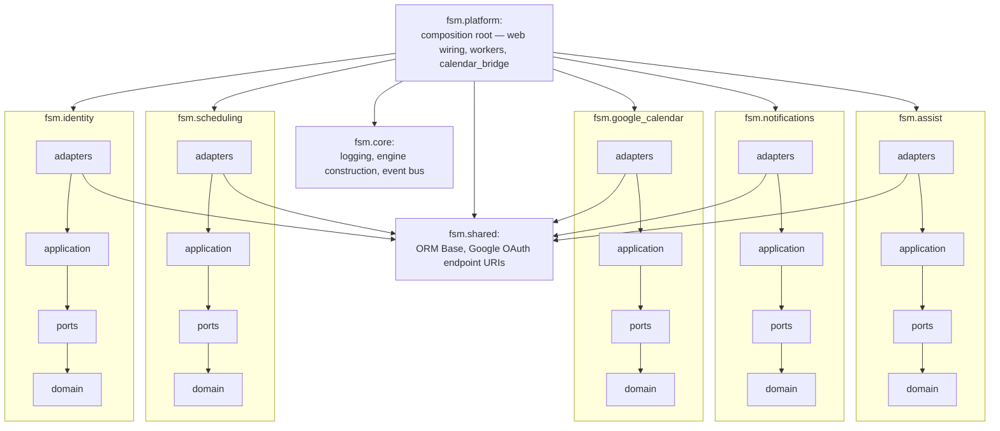

# Design patterns

This document details the shapes the code repeats behind
[Architecture](architecture.md#codebase-structure): the bounded contexts of the backend, the
import rules between them, how one context reaches another without importing it, and how the
rules are enforced.

**Contents:** [Bounded contexts](#bounded-contexts) · [Import rules](#import-rules) ·
[How contexts integrate](#how-contexts-integrate) · [Enforcement in CI](#enforcement-in-ci)

## Bounded contexts

The backend is a modular monolith: bounded contexts under the single `fsm` package in
`backend/src`, each layered ports-and-adapters style and composed by `fsm.platform`.

- `assist` — knowledge base and AI triage chat for the customer channel (LangChain/pgvector behind
  ports).
- `identity` — Google OIDC sign-in, users, roles.
- `scheduling` — service calls, appointments, availability, lifecycle — the core domain (no
  external I/O).
- `google_calendar` — Google Calendar connections and the raw API client behind the
  `GoogleCalendarClient` port.
- `notifications` — in-app feed for both parties + technician email behind `NotificationPort`.
- `platform` — composition root: configuration, database, web wiring, background workers, and the
  conformance bridges that implement one context's ports in terms of another (e.g.
  `calendar_bridge` implements scheduling's `CalendarPort` over the google_calendar context's
  client).
- `shared` — shared kernel: the declarative ORM `Base`, Google OAuth endpoint URIs, and product
  identity constants (the brand name) — the only package a context may import from outside
  itself.
- `core` — app-agnostic plumbing any backend process needs: structured logging, engine
  construction, and the publish/subscribe event bus. Knows nothing of this product — the
  log-level environment prefix, the pool sizing, the broker URL, and the channel names all arrive
  from `platform`.

## Import rules

Arrows read **may import**. There are no arrows between contexts — none may import another — and
none from a context up to `platform`:

The three inner layers (`application`, `ports`, `domain`) use only their own context, the standard
library, and `shared.constants` (the product brand). Only `adapters` may import the rest of `shared`
(the ORM `Base`, OAuth URIs) and infrastructure libraries (SQLAlchemy, Google clients).

`core` has no arrows out of it at all — it may import neither a context, nor `shared`, nor
`platform`, nor the web framework — and only `platform` has an arrow into it. Both directions are
contracts, so a context cannot grow a dependency on the plumbing either: what a context needs is
injected through its own ports. That is what keeps the event bus a transport — it carries dicts on
named channels and never learns that `admins` is a channel or that only an approved administrator
may open it, which `platform.events` decides.

## How contexts integrate

Contexts integrate without knowing each other. The consumer declares an interface in its own
`ports` package (`scheduling.ports.CalendarPort`), and `platform` builds and injects the
implementation (`platform.calendar_bridge.GoogleCalendarAdapter`, written against the
google_calendar context's `GoogleCalendarClient` port). Application code receives its dependencies
as constructor arguments and names only these interfaces, never concrete adapters.

## Enforcement in CI

The import rules are executable: the import-linter contracts in `backend/pyproject.toml`
(`[tool.importlinter]`, run as `lint-imports` or via `backend/tests/test_architecture.py`) fail
the build on any import outside this shape — including one reached transitively through another
module.
