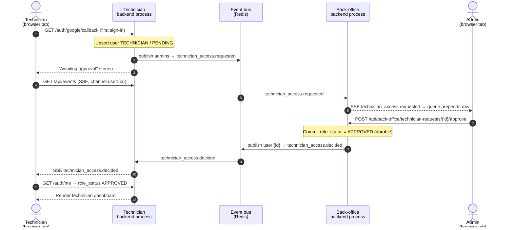
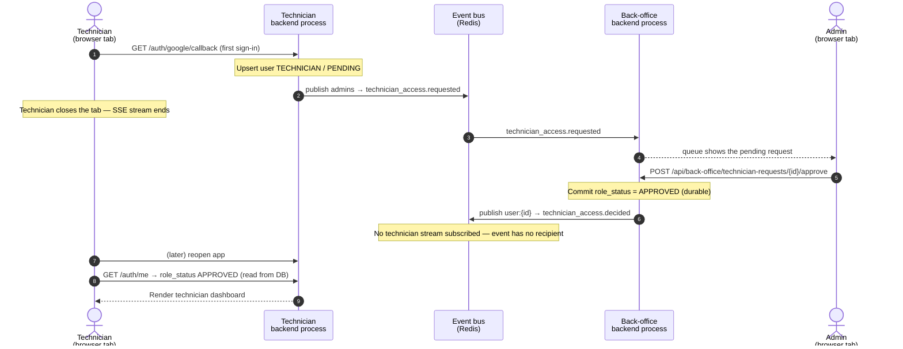

# Live events across replicas

This document details the live events behind
[Architecture](architecture.md#sign-in-and-live-events): how an event raised in one role process
reaches a browser tab held by another, traced through the back office's approval of a technician,
and what running a role on several replicas requires. Once signed in ([Sign-in](sign-in.md)), the
frontend drives the system with ordinary REST [1] calls and receives live updates over a single
Server-Sent Events [2] stream; a Redis pub/sub [3] bus carries those events between the per-role
processes, so a push raised in one process reaches a stream held by another.

This page traces the flows end-to-end — how the browser tabs, the per-role backends and the event
bus talk to each other — without diving into the code. Terms that aren't obvious are clarified
just enough to follow the flow in the [Glossary](#glossary); this is a map of *this app*, not a
primer on REST or SSE.

## Reading the diagrams

Every `GET`/`POST` arrow is a browser tab talking to its own backend process (or that backend
calling Google); backends never talk to each other directly, only through the bus.

The two arrow styles separate what *starts* an exchange from what comes *back*. The style encodes
direction, not transport — the label names the transport.

| Arrow | Style | Meaning |
| --- | --- | --- |
| `->>` | solid | A message the sender initiates: an HTTP request from the browser, a backend calling Google, or a `publish` onto the bus. |
| `-->>` | dashed | Something sent back to the recipient — an HTTP response that renders a screen or returns data, or an SSE push. The label disambiguates: arrows tagged `SSE` are stream pushes; the rest are ordinary HTTP responses. |

Reading top to bottom shows just one possible ordering, chosen for readability — a higher arrow does
not necessarily happen before a lower one. Two steps are ordered only when they share a participant
or have a real causal dependency (a response to its request, or a delivery of a publish). Steps on
independent branches — such as the bus delivering a request to the back office versus the technician
opening their SSE stream — can happen in either order.

### Glossary

Minimal, app-specific clarifications — just enough to read the flows, not full definitions.

| Ref | Term | Meaning in this app |
| --- | --- | --- |
| [1] | REST | The ordinary request/response HTTP calls the frontend uses for reads and writes. |
| [2] | SSE — Server-Sent Events | The one-way stream (one per browser tab, at `GET /api/events`) the backend uses to push live updates. Each connection receives only its owner's channel — `user:{id}`, plus `admins` for an admin. |
| [3] | pub/sub | The Redis channel mechanism that carries events between the per-role processes, so a push from one process reaches a tab connected to another. |
| [4] | funnel | The host→role mapping: each role runs behind its own host, and that host fixes which role (`FSM_ROLE`) a completed sign-in grants — never a client choice. |

## Flows

Both flows trace the technician's onboarding and the back office's approval of it; the sign-in
they start from is traced in [Sign-in](sign-in.md#how-it-works).

### Technician approval — dashboard live

A technician onboarding requests access on first sign-in, and the back office approves it once. When
the technician is sitting on the "Awaiting approval" screen with its SSE stream open, the decision
reaches them in real time and the view flips to the dashboard with no refresh.



### Technician approval — dashboard not live

If the technician has closed the tab, no stream is subscribed to their `user:{id}` channel, so the
`technician_access.decided` event is published but reaches no one. Correctness does not depend on
it: the decision is committed to `app_user.role_status`, and the next time the technician loads the
app, `GET /auth/me` resolves that status live from the database and renders the dashboard directly.
SSE is an accelerator for the open-tab case, never the system of record.



The mirror image is symmetric: a `reject` decision sets `role_status = REJECTED` the same way, and a
pending technician who signs out before approval triggers `technician_access.withdrawn`, removing
their row from the live back-office queue.

## Running a role across several replicas

The flows show one process per role, reached in development on a fixed port (`:8001` technician,
`:8002` customer, `:8003` back office). That port is only each role's local **edge** — not a slot
the role occupies, and not something replicas share. The role a sign-in grants comes from the
process's own `FSM_ROLE` config (its funnel [4]; `_sign_in_host` maps `FSM_ROLE` → role),
never from the port or host. So scaling a role horizontally just means running several processes
that all set the same `FSM_ROLE`: each is an independent process bound to its own address, and a
load balancer fronts them under that role's public host, spreading requests across them. Replicas
never contend for a port, and replication never changes which role a sign-in grants.

For example, one back office, two technician, and five customer processes is how
[`docker-compose.yml`](../docker-compose.yml) is wired — the role is the only difference between the
backend services, and only nginx holds a port (trimmed here to the essentials):

```yaml
# One built image; role services differ only by FSM_ROLE, so a role's replicas are interchangeable.
x-fsm: &fsm
  image: fsm-backend:local
  environment: &env
    SESSION_SECRET:                   # one shared value → any replica accepts any session cookie
    REDIS_URL: redis://redis:6379/0   # carries SSE events across replicas

services:
  nginx:                                # the only service that publishes host ports
    image: fsm-nginx:local
    ports: ["8001:8001", "8002:8002", "8003:8003"]

  backoffice: { <<: *fsm, environment: { <<: *env, FSM_ROLE: backoffice }, deploy: { replicas: 1 } }
  technician: { <<: *fsm, environment: { <<: *env, FSM_ROLE: technician }, deploy: { replicas: 2 } }
  customer:   { <<: *fsm, environment: { <<: *env, FSM_ROLE: customer   }, deploy: { replicas: 5 } }
```

The role services publish no host port, so nginx reaches them on the Docker network instead. It does
not discover them — the mapping is declared: each role is an `upstream` naming the Compose service
and the container port its uvicorn listens on (see [`nginx/default.conf`](../nginx/default.conf)):

```nginx
upstream technician_backend { server technician:8001; }   # 'technician' resolves to both replicas
upstream customer_backend   { server customer:8002; }     # 'customer' resolves to all five
upstream backoffice_backend { server backoffice:8003; }
```

Compose's built-in DNS resolves a service name to the IPs of all its replicas, so one `server
technician:8001` line spreads requests across every technician process.

The replicas all listen on the same port number without conflict because a port belongs to a network
namespace, not to the machine. Each container has its own namespace and IP, so the two technicians
bind `8001` on `172.18.0.5:8001` and `172.18.0.6:8001` — distinct addresses, like two separate
servers both using port 8001. A bind conflict needs the *same* port on the *same* namespace, which
is why running the roles as bare processes on one host instead requires distinct ports
(`8001/8002/8003`), and why no role service publishes a host port — only `nginx` does.

Two infrastructure conditions make a multi-replica role safe:

- **Share `SESSION_SECRET` across every replica.** The session is a signed cookie with no
  server-side store, and the OAuth `state` and PKCE `code_verifier` ride inside it. A login that
  begins on one replica and whose callback lands on another completes correctly as long as both
  verify with the same secret — so **sticky sessions are not required**, even for the OAuth
  handshake.
- **Set `REDIS_URL`.** With more than one process the in-process event bus cannot reach across
  replicas; the Redis bus carries each SSE event to subscribers on every replica, so a client
  connected to one instance still receives events published by another.

One process is not a role funnel at all: the background calendar workers run in a `worker`
deployment of their own, which serves no HTTP
([Workers' responsibilities and flows](workers.md#the-worker-service)).

What each secret does is documented beside it in the settings files under `scripts/lib/`
([Development & deployment](development.md#configuration)), and [Sign-in](sign-in.md) obtains the
Google credentials.
