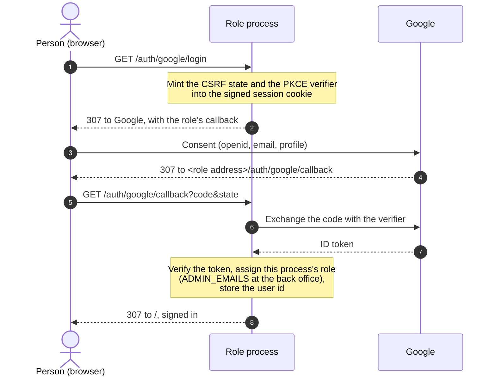

# Sign-in

People sign in to every role app with a Google account, and there is no other way in, so there
is no password store to protect: every booking and scheduling route needs a signed-in session.
The same Google client also lets a technician connect their Google Calendar. This page explains
how sign-in works, how to set up the Google side, what the sign-in guarantees and how long each
credential lives, behind [Architecture](architecture.md#sign-in-and-live-events).

**Contents:** [How it works](#how-it-works) · [Setting up Google](#setting-up-google) ·
[Who may sign in](#who-may-sign-in) · [Security guarantees](#security-guarantees) ·
[Token and session lifetimes](#token-and-session-lifetimes)

## How it works

Each role app runs behind an address of its own: on this machine a port per role, on EC2 a
CloudFront distribution per role. The process that starts a sign-in also finishes it, and the role
a sign-in grants comes from that process's `FSM_ROLE`, never from the browser.

The callback is the role's own address followed by `/auth/google/callback`. On this machine it is
derived from the request's host, so a sign-in begun on `localhost:8003` returns to `localhost:8003`.
On EC2 it is set from the role's CloudFront address (`docker-compose.ec2.yml`), since CloudFront
reaches the edge over plain HTTP and a derived callback would name http, which Google refuses for a
public host. The session is a cookie signed with `SESSION_SECRET` and holds only the user id; the
role and its approval are read from the database on every request.

Connecting a calendar is a second consent on the same client, from the technician app only, with its
own callback, `/calendar/connect/callback`. It asks for two narrow scopes, `calendar.app.created` (a
calendar the app creates, and its events) and `calendar.freebusy` (busy and free times only), so the
technician's other calendars stay invisible to the app; `backend/src/fsm/google_calendar/scopes.py`
defines them. The refresh token Google returns is stored encrypted with `FSM_TOKEN_KEY`. [Google
Calendar connect](calendar-setup.md#how-connecting-works) traces the connect flow.

## Setting up Google

The app needs its own Google Cloud project with one OAuth client.

1. **Create the project.** In the [Google Cloud console](https://console.cloud.google.com/), open
   the project picker at the top of the page, choose **New project**, name it
   `field-service-management` and create it. Make sure the picker now shows that project:
   everything below is per project.
2. **Enable the Calendar API.** Open **APIs & Services → Library**, search for **Google Calendar
   API**, open it and choose **Enable**. The technicians' calendars and the holiday calendar use
   it.
3. **Configure the consent screen.** Search the top bar for **Google Auth Platform** and open it
   (older consoles reach the same place as **APIs & Services → OAuth consent screen**). A new
   project shows **Get started**; the wizard asks for an app name, which people see when they sign
   in, and a support email; then the audience, where you choose **External**; then a contact email
   and your agreement to Google's policy. **Create** finishes it. The app is now in **Testing**.
4. **Add the scopes.** Open **Data Access → Add or remove scopes**. Select `openid`,
   `.../auth/userinfo.email` and `.../auth/userinfo.profile` for sign-in, then filter for
   `calendar` and select `.../auth/calendar.app.created` and `.../auth/calendar.freebusy`; paste
   either into **Manually add scopes** if it is not listed. Leave the broad `.../auth/calendar`
   scope unselected. Choose **Update**, then **Save**: all five appear under **Your non-sensitive
   scopes**.
5. **Add the test users.** Open **Audience** and, under **Test users**, add the Google account of
   every person who may sign in: yourself, the administrators, the technicians and the customers.
6. **Create the client.** Open **Clients → Create client**, choose **Web application** and give it
   a name. No JavaScript origin is needed: the role processes redeem the codes themselves. Under
   **Authorized redirect URIs** add these four, verbatim, one sign-in callback per role port and
   the technician's calendar callback:
   - `http://localhost:8001/auth/google/callback`
   - `http://localhost:8002/auth/google/callback`
   - `http://localhost:8003/auth/google/callback`
   - `http://localhost:8001/calendar/connect/callback`

   Google accepts a loopback redirect URI only as `localhost` with a port, not a subdomain of
   `localhost`, which is why each role has a port of its own. If you change a port in
   `scripts/lib/stack-params.sh`, change its URIs to match. **Create** shows the client id, a long
   string ending in `.apps.googleusercontent.com`, and the client secret.
7. **Give it to the stack.** Copy the client id into `GOOGLE_CLIENT_ID` of `scripts/lib/params.sh`
   and the secret into `GOOGLE_CLIENT_SECRET` of `scripts/lib/secrets.sh`, the files
   `./scripts/init-env.sh` wrote with those keys blank. Put the Google accounts of the
   administrators, comma separated, in `ADMIN_EMAILS` of `params.sh`.
8. **Optionally, read the public holidays.** Open **APIs & Services → Credentials → Create
   credentials → API key**, restrict the key to the Google Calendar API, and copy it into
   `GOOGLE_API_KEY` of `secrets.sh`; then set `HOLIDAY_CALENDAR_ID` of `stack-params.sh` to a
   public holiday calendar. This key is a separate credential from the OAuth client.
9. **Start the stack.** Run `./scripts/deploy.sh`, then sign in to the back office at
   http://localhost:8003 with an account of `ADMIN_EMAILS`.

A stack deployed with `./scripts/deploy.sh --ec2` is reached at three CloudFront addresses, one
per role, which the script prints with the four redirect URIs to add to the same client:
`https://<technician distribution>.cloudfront.net/auth/google/callback`, the same for the customer
and back-office distributions, and
`https://<technician distribution>.cloudfront.net/calendar/connect/callback`. A deployment with a
client of its own adds those four alone.

A technician whose calendar connect is refused, or who connected before a scope change, follows
[Google Calendar connect](calendar-setup.md).

## Who may sign in

The test users of the Google client are the access list: while the app is in **Testing**, Google
signs in nobody else, and each test user passes a one-time "Google hasn't verified this app"
screen through **Advanced**. Google limits a testing app to 100 test users. Publishing the app
admits any Google account, and every customer turn of the triage chat calls the paid model, so the
app stays in testing mode.

Within the test users, the app grants each role at its own address:

- **Customer** — anyone who signs in at the customer app.
- **Technician** — anyone who signs in at the technician app asks for the role, and an
  administrator approves or rejects the request in the back office before customers can book them.
- **Administrator** — only an account listed in `ADMIN_EMAILS`, on its first sign-in at the back
  office; the back office refuses every other account.

Under its "Sign in with Google" button, the landing page has a "Why sign in with Google?" toggle
that explains why signing in with Google is safe and links to Google's own help page. It covers
signing in only; the calendar access a technician grants later is asked for on its own consent
screen.

## Security guarantees

- **CSRF on the OAuth handshake.** `/auth/google/login` mints a random `state` into the session and
  the callback rejects any mismatch with a constant-time compare. A PKCE `code_verifier`, a secret
  presented when the code is redeemed so a stolen code is useless to anyone else, rides the same
  session so the separately-built callback flow can complete the exchange.
- **Sessions are signed, not stored.** The cookie carries only `user_id`; `SESSION_SECRET` signs it.
  Blank `SESSION_SECRET` means no session middleware is mounted and every sign-in fails.
- **Role and status are read live.** The session holds only `user_id`; `/auth/me` re-resolves `role`
  and `role_status` from the database on every call, so a just-approved technician advances without
  re-authenticating, and a revoked one loses access on their next request.
- **Roles come from the process, not the client.** The role is assigned from the `FSM_ROLE` of the
  process that completes the callback — each role runs as its own process behind its own edge host.
  The back-office role additionally requires the email to be in `ADMIN_EMAILS`; other edges fall
  back to the customer/technician funnels. There is no client-supplied role.
- **Refresh tokens are encrypted at rest.** A technician's stored Google refresh token is encrypted
  with `FSM_TOKEN_KEY`; rotating that key makes existing calendar connections undecryptable.
- **Live streams carry only the caller's own channels.** The SSE stream subscribes a connection to
  `user:{id}`, plus `admins` for an approved administrator, and to nothing else — so a client cannot
  listen in on back-office events by asking.

## Token and session lifetimes

Three different credentials are in play, each with its own lifetime. None of them needs an expiry
knob in the configuration, which is why none appears in the settings files — the absence is
deliberate, not an oversight.

- **The Google ID token (JWT) is used once and discarded.** At `/auth/google/callback` the token's
  signature, audience, and expiry are checked in that single moment (with a few seconds of
  clock-skew leeway), the email is extracted, and the token is thrown away — it is never stored. Its
  validity window is therefore Google's concern, not a setting here.
- **The session cookie carries the user across requests, with a 14-day default lifetime.** It is a
  signed cookie holding only `user_id`, backed by no server-side record. The session middleware is
  mounted without an explicit `max_age`, so it inherits Starlette's default lifetime of 14 days;
  past that the signature is treated as stale and the user signs in again. Because `role` and
  `role_status` are not in the cookie but re-read from the database on every `/auth/me`, even a
  days-old cookie still reflects an account approved or revoked since it was issued.
- **The Google Calendar refresh token is stored; the access token it yields is not.** The refresh
  token is the only credential persisted at rest, encrypted with `FSM_TOKEN_KEY` (Fernet). It has no
  timer — it stays valid until the technician revokes access, Google invalidates it, or the
  encryption key is rotated. What does expire is the short-lived access token derived from it, and
  that is never stored: the client factory builds Google credentials with no access token and only
  the refresh token, so the google-auth library exchanges the refresh token for a fresh access token
  on first use and silently re-refreshes it whenever it lapses (roughly hourly). The application
  never schedules or sees that refresh, which is why there is no access-token column and no expiry
  to tune.
